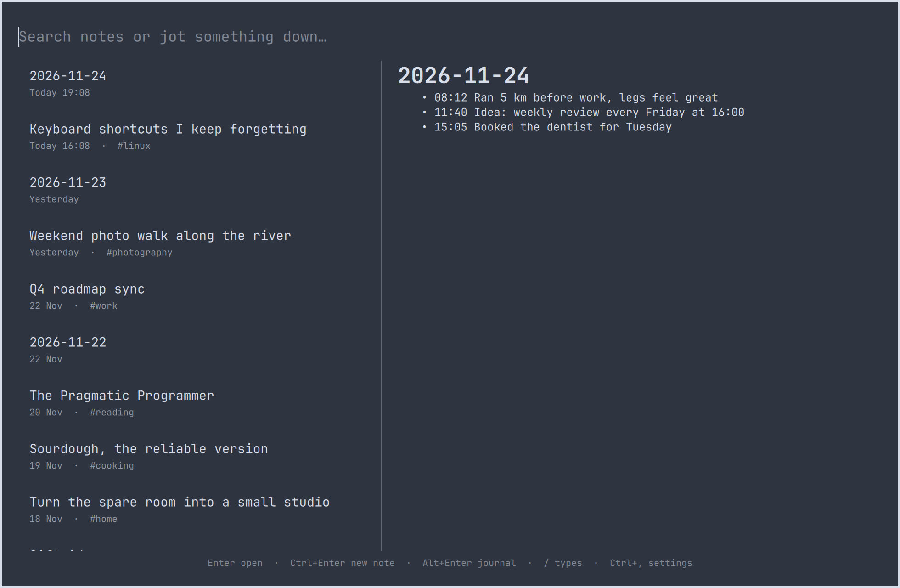
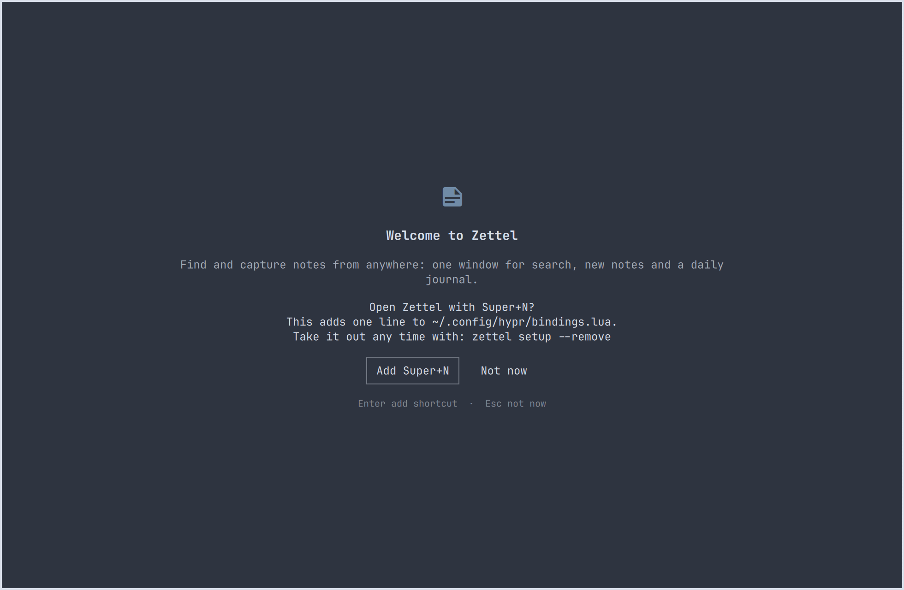
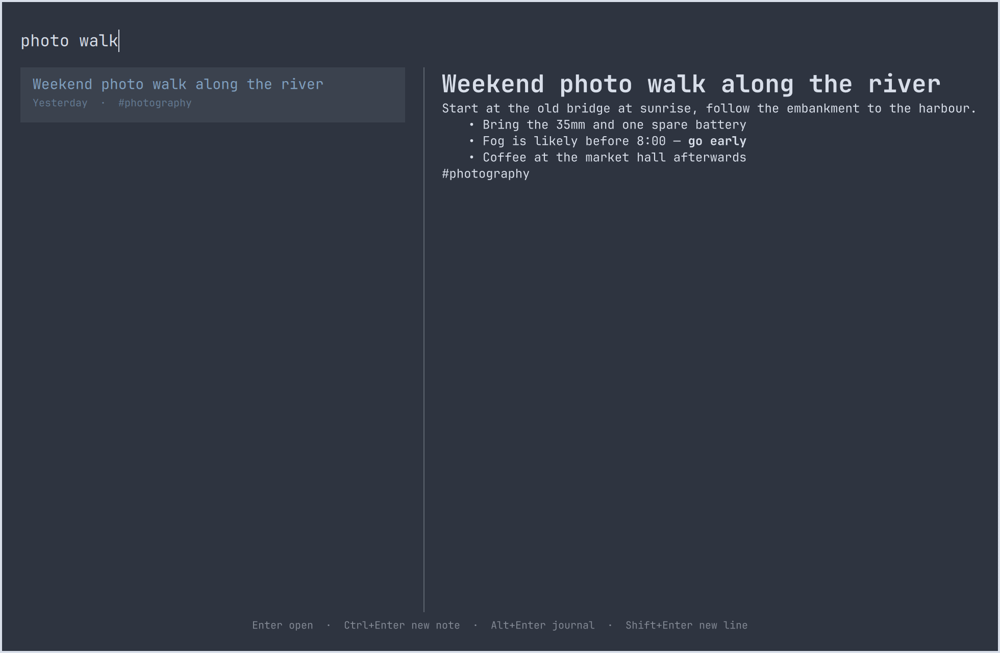
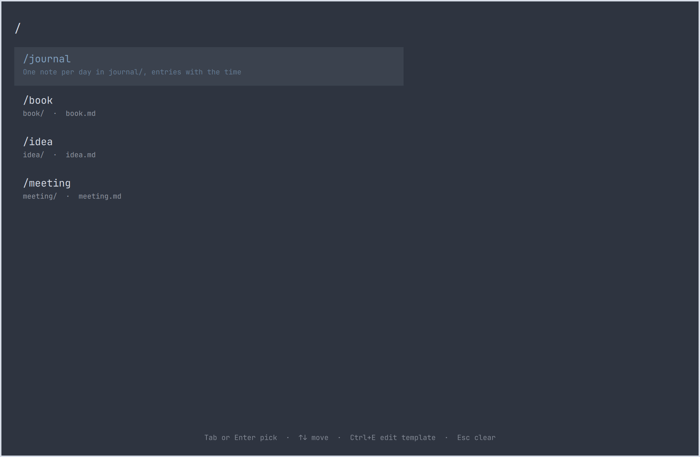
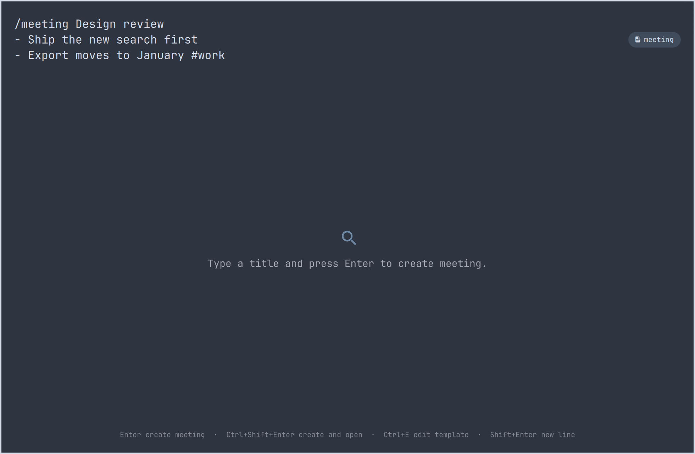

# Zettel

Find and capture notes from anywhere on your [Omarchy](https://omarchy.org) desktop.

Press **Super+N**, start typing. Zettel searches every note as you type and shows the best match on the right. Press **Enter** to open it, or **Ctrl+Enter** to save what you typed as a new note. **Alt+Enter** adds it to today's journal instead. Esc, and you are back where you were.



Notes are plain Markdown files in a folder you own, managed by [zk](https://github.com/zk-org/zk). Zettel is only the window: your notes work the same in any editor, in git, in Syncthing, or with zk on the command line.

- **One shortcut** for searching and writing, so a note you already have shows up before you write a duplicate.
- **A daily journal**: one file per day, each entry stamped with the time.
- **Note types**: type `/` to pick one, or name a new one and Zettel creates it with its own folder and template.
- **Several notebooks**, searched together; Tab picks where a new note goes.
- **Forgiving search**: matches the start of words, ignores case, and when nothing matches tries again without word endings and with е/ё treated alike.
- **Follows Omarchy**: its theme, its language, and your default editor.

## Requirements

- Omarchy 4 (the Quickshell shell with plugin support)
- [zk](https://github.com/zk-org/zk) and jq. If either is missing, Zettel shows an Install button that installs both with `omarchy pkg add`.

## Install

```bash
omarchy plugin add https://github.com/lipchanskiy/omarchy-zettel --enable
```

Right after it is enabled, Zettel opens once with a welcome screen and asks before it touches your Hyprland config:



- **Enter** binds **Super+N** with one line in `~/.config/hypr/bindings.lua`. If Super+N is taken, it offers Super+Alt+N, then Super+Shift+Alt+N. The search window opens right away.
- **Esc** adds no shortcut. Run `zettel setup` later whenever you want one, or bind `lipchanskiy.zettel` yourself (see [Settings](#settings)).

Either way Zettel links the `zettel` command into `~/.local/bin`, writes its settings file, `~/.config/zettel/config.jsonc`, with every option explained, and creates your notebook in `~/Notes` the first time you open the window. It asks only once.

Nothing else on your system changes. `zettel setup --remove` takes the shortcut and the command back out.

## Using Zettel

| Key | What it does |
|---|---|
| **Super+N** | Open or close Zettel |
| typing | Search all notebooks; the selected note is previewed on the right |
| **Enter** | Open the selected note in your editor. With no match, save the text (as Ctrl+Enter). Pressed while a search is still running, it waits for that search |
| **Ctrl+Enter** | Save as a new note (first line is the title) |
| **Alt+Enter** | Add to today's journal |
| **Ctrl+Shift+Enter** | Save as a new note and open it |
| **Shift+Enter** | New line |
| **↑ ↓**, **Ctrl+P/N**, **PgUp/PgDn** | Move through results |
| **Tab** | Choose the notebook new notes go to (with several notebooks) |
| **/** | Note types, see below |
| **Ctrl+E** | Edit the template of the selected note type |
| **Ctrl+K** | Open both versions of a sync conflict, see [Conflicts](#if-a-conflict-shows-up) |
| **Ctrl+,** | Open the settings |
| **Esc** | Clear the text, then close |

Ctrl+Enter and Alt+Enter swap if you set `"defaultCapture": "journal"`.

| Search | Note types | A typed note |
|---|---|---|
|  |  |  |

**Tags.** `#word` anywhere in a search filters by tag (`#wor` finds `#work`). In a new note, hashtags on the first line move out of the title into the text, where zk sees them as tags.

### The journal

Alt+Enter appends what you typed to today's journal, `journal/2026-11-21.md`, as `- 14:05 what you typed`. Several lines stay together under one entry. The first entry of the day writes the heading, the date in your language. `journalFolder` and `journalTimestamps` in the settings change the folder and the time stamps. Outside Zettel, `zk daily` opens the same file.

### Note types

Type `/` to see them. The journal is always first; after it come the zk groups and templates of the notebook. Pick one with Tab or Enter, then type a title:

```
/recipe Borscht
```

and Enter creates the note in the type's folder, from its template.

**Make your own.** Type `/` and a name that does not exist yet, such as `/recipe`. The list offers *Create type "recipe"*; Enter adds a `recipe/` folder and a `.zk/templates/recipe.md` template to the notebook. **Ctrl+E** on a type opens its template, so you can give it the sections you want. A name is one word, without spaces, quotes, slashes, dots, brackets or the characters Windows does not allow in folder names (`: * ? < > |`). Hand-written groups whose names contain a space do not show up in the list.

A type is an ordinary zk [group](https://zk-org.github.io/zk/config/config-group.html), so you can also write one by hand in `NOTEBOOK/.zk/config.toml`:

```toml
[group."recipe"]
paths = ["recipe"]

[group."recipe".note]
template = "recipe.md"
```

Templates are [Handlebars](https://zk-org.github.io/zk/notes/template.html). Besides zk's own variables, Zettel passes the date in your language as `{{extra.date}}` and the weekday as `{{extra.weekday}}`, and puts what you typed after the title into `{{content}}`. If a template has no `{{content}}`, Zettel adds the text at the end of the note so nothing is lost.

## Notebooks

A notebook is a folder of Markdown files with a `.zk` folder inside. Zettel starts with one, `~/Notes`. To add another, and create it if needed:

```bash
zettel notebook add Work ~/Work/notes
```

or add it to `notebooks` in the settings. With more than one notebook, every search covers all of them, each result shows its notebook, and Tab picks the notebook a new note goes to.

A notebook in the settings whose folder does not exist yet, or is empty, is created the next time Zettel opens. Zettel never turns a folder that already has files into a notebook on its own; the bottom of the window lists such folders as *Not a notebook yet*. To use one, for example a folder of Markdown notes you already have, run `zettel init PATH` (or `zettel notebook add NAME PATH` for a folder that is not in the settings yet): that adds `.zk`, `inbox` and `journal` folders and leaves your files as they are.

## Syncing between computers

Zettel has no sync of its own and needs none: a notebook is a folder, so anything that syncs folders works. What Zettel does is make that safe:

- **zk's index stays out.** `.zk/notebook.db` is a database each computer builds for itself; synced between two machines it breaks. New notebooks come with a `.gitignore` and a `.stignore` that leave it out, and zk rebuilds it on its own wherever it is missing.
- **The journal merges.** Two computers adding to the same day's journal is normal. A `.gitattributes` line makes git combine both sets of entries instead of stopping on a conflict.
- **Conflicts are not silent.** When a sync tool keeps two versions of a note side by side (`*.sync-conflict-*`, `* (… conflicted copy …)`, `*.conflict1`, …) or a git merge stopped half way, the bottom of the Zettel window says so and names the file. See [below](#if-a-conflict-shows-up).

A notebook made before Zettel knew about sync, or made with zk directly, gets the same files with `zettel init PATH`. It adds only what is missing and leaves your own lines alone.

### Syncthing

[Syncthing](https://syncthing.net) keeps a folder the same on your own computers, directly between them, with no account and no cloud. Changes arrive within seconds while both computers are on, and catch up when one comes back.

```bash
omarchy pkg add syncthing
systemctl --user enable --now syncthing
```

Open http://127.0.0.1:8384 on both computers, add each one as a device of the other, and share your notebook folder. The `.stignore` Zettel wrote keeps the index out.

### git

Gives you history and an off-site copy, and is a good fit if you already use GitHub or similar. Once, on the first computer:

```bash
cd ~/Notes
git init && git add -A && git commit -m "Notes"
gh repo create notes --private --source . --push     # or any private remote
```

On the other computer, `git clone` it to the same place. Then sync whenever you like:

```bash
git -C ~/Notes pull --rebase && git -C ~/Notes add -A && \
  (git -C ~/Notes commit -qm "Notes from $(hostname)" || true) && git -C ~/Notes push
```

Put that in an alias, a script on a shortcut, or a systemd timer. Zettel does not run git for you.

### Dropbox, Nextcloud, Google Drive, OneDrive

Keep the notebook inside the folder the client syncs, and point Zettel at it:

```bash
mv ~/Notes ~/Dropbox/Notes
zettel notebook remove Notes          # if it was in the settings under its old path
zettel notebook add Notes ~/Dropbox/Notes
```

These clients do not read `.stignore`, so exclude `.zk/notebook.db` in the client itself:

| Client | How to exclude the index |
|---|---|
| Dropbox | `attr -s com.dropbox.ignored -V 1 ~/Dropbox/Notes/.zk/notebook.db` |
| Nextcloud | Settings → *Edit ignored files* → add `.zk/notebook.db*` |
| Google Drive via [rclone](https://rclone.org/bisync/) | `rclone bisync … --exclude ".zk/notebook.db*"` |
| OneDrive via [onedrive](https://github.com/abraunegg/onedrive) | `skip_file = "notebook.db"` in its config |

Omarchy can install and start Dropbox with `omarchy-install-service-dropbox`.

### If a conflict shows up

A conflict happens when the same note was changed on two computers before they synced. The sync tool can't know which version is right, so it keeps both: your note, and a copy next to it with a name like `idea.sync-conflict-20261124-101010-ABCDEFG.md`. Nothing is lost.

In Zettel, both files are marked with ⚠ in the list, and the preview says which file is the copy and which is the original. To resolve it:

1. Select either file and press **Ctrl+K**. Each version opens in its own editor window.
2. Move whatever you want to keep from the copy into the original.
3. Delete the copy.

The warning disappears once the copy is gone. Zettel never merges or deletes anything on its own. For a git merge that stopped half way, Ctrl+K opens the file with the conflict markers; fix it and commit as usual.

## Using your notes elsewhere

A Zettel notebook is an ordinary [zk](https://github.com/zk-org/zk) notebook: Markdown files, `[[wiki links]]` and `#tags`, with zk's configuration in `.zk/`. Zettel adds nothing that only Zettel can read, so on any other computer, Linux, macOS or Windows, you can work with the same notes in any Markdown editor, or with zk itself:

- **zk on the command line.** `zk list`, `zk edit --interactive`, `zk new`, and `zk daily`, which opens today's journal, the same file Zettel's Alt+Enter writes to.
- **zk in your editor.** zk ships a language server, so your editor gets link completion, jumping between notes and backlinks: [zk-nvim](https://github.com/zk-org/zk-nvim) for Neovim, [zk-vscode](https://github.com/zk-org/zk-vscode) for VS Code, and [others](https://zk-org.github.io/zk/tips/editors-integration.html).
- **Any Markdown editor**, if you only want to read and write.

Journal entries written by hand follow the same shape as Zettel's, `- 14:05 what happened`, one file per day in `journal/`. Note types are zk groups, so `zk new recipe` puts a note in the `recipe` folder with its template, as `/recipe` does in Zettel.

Get the files there with any of the ways in [Syncing between computers](#syncing-between-computers). Notebooks keep Markdown files with LF line endings in git, so a Windows editor does not turn every line of a note into a change.

A notebook Zettel created before these conventions existed gets them, along with the sync files, from `zettel init PATH`: today's-journal alias, a dated journal template for zk, and the line-ending rule. It changes only what is still as Zettel first wrote it.

## Settings

**Ctrl+,** in the Zettel window opens `~/.config/zettel/config.jsonc`. Changes apply when you save.

```jsonc
{
  "notebooks": [
    { "name": "Notes", "path": "~/Notes" },
    { "name": "Work", "path": "~/Work/notes" }
  ],
  "defaultNotebook": "Notes",     // where new notes and journal entries go
  "defaultCapture": "note",       // Ctrl+Enter: "note" or "journal"; Alt+Enter does the other
  "inboxFolder": "inbox",         // folder for new notes; "" for the top of the notebook
  "journalFolder": "journal",
  "journalTimestamps": true,      // "- 14:05 ..." or "- ..."
  "editor": ""                    // empty: Omarchy's default editor (omarchy default editor)
}
```

`editor` takes a command such as `code` or `nvim`. Terminal editors (nvim, vim, helix, nano, micro, kakoune, emacs, fresh) open in a terminal window. If the file has a syntax error, Zettel says so at the bottom of the window and uses the defaults until it is fixed. `zettel notebook add|remove|default` rewrite the file from its template, so comments you add yourself are not kept. A symlinked settings file (stow and other dotfile managers) stays a symlink.

To change the shortcut, edit the line Zettel added to `~/.config/hypr/bindings.lua`:

```lua
o.bind("SUPER + N", "Notes", { panel = "lipchanskiy.zettel" })
```

### Trusting a notebook

zk runs commands written in a notebook's own settings: an `[alias]` in `.zk/config.toml` can replace a zk command, `[tool]` names the programs zk starts, and templates can call `{{sh}}`. A notebook that arrives through sync, git or an archive could carry such a command, and Zettel calls zk every time the window opens.

So Zettel uses a notebook only while its `.zk` folder is exactly as you last trusted it. Notebooks Zettel creates, and changes Zettel itself makes (a new note type, `zettel init`), are trusted on the spot. When anything else in `.zk` changes, whether you edited a template or the change came from another machine, the window shows what changed, line by line, before doing anything with that notebook:

| Key | Does |
|---|---|
| Enter | Open the notebook's settings in your editor |
| Ctrl+Enter | Trust the notebook as it is now |
| Esc | Not now: the notebook stays off (no search, no new notes, no journal) and the window asks again next time |

From a terminal: `zettel trust --diff PATH` shows the changes, `zettel trust PATH` trusts them, and `zettel trust --forget PATH` takes trust back.

Trust is kept per folder on this computer, in `~/.local/state/zettel/`. Each computer that syncs the notebook asks once on its own.

To show what changed, Zettel keeps a copy of the trusted `.zk` there, readable only by you. It holds just the text files inside `.zk`. A link leading outside the notebook, a binary file or a file over 256 KB is neither copied nor shown: the copy notes only its fingerprint, so a change to it still shows up.

## The `zettel` command

The window runs everything through `zettel`, and it works on its own too. Every command prints JSON.

```bash
zettel notebook list                     # notebooks and the default one
zettel notebook add NAME PATH            # add a notebook, creating it if needed
zettel notebook remove NAME
zettel notebook default NAME
zettel config                            # create the settings file if missing, print its path
zettel setup                             # bind the shortcut and link the command
zettel setup --remove                    # undo both
zettel init PATH                         # create a notebook, or bring an existing one up to date
zettel trust PATH                        # trust a notebook's .zk settings as they are now
zettel trust --diff PATH                 # what changed in .zk since it was trusted
zettel trust --forget PATH               # stop trusting a notebook
zettel types --nb NAME PATH              # note types of a notebook
zettel types add TYPE --nb NAME PATH     # add a note type
zettel search --nb NAME PATH -- QUERY    # search (repeat --nb for several notebooks)
zettel new --nb NAME PATH -- TEXT        # new note; also --type TYPE, --inbox DIR
zettel daily --nb NAME PATH -- TEXT      # journal entry; also --journal DIR, --no-timestamps
```

For anything beyond this, use [zk](https://zk-org.github.io/zk/) itself: `zk list`, `zk edit --interactive`, its LSP in your editor, and so on.

## Where things live

| What | Where |
|---|---|
| Your notes | `~/Notes` and any other notebook folder |
| zk's index and templates | `NOTEBOOK/.zk/` |
| Zettel's settings | `~/.config/zettel/config.jsonc` |
| The shortcut | `~/.config/hypr/bindings.lua` |
| The `zettel` command | `~/.local/bin/zettel`, a link into the plugin |
| First-run record | `~/.local/state/zettel/setup.json` |
| Trusted notebooks | `~/.local/state/zettel/trusted.json` and `trusted/`, a private copy of the text files in each trusted `.zk` |
| The plugin | `~/.config/omarchy/plugins/lipchanskiy.zettel/` |

## Update and uninstall

```bash
omarchy plugin update lipchanskiy.zettel
omarchy-restart-shell
```

The shell does not always pick up a plugin's new code on its own; restarting it does.

To uninstall, remove the shortcut and the command first, then the plugin:

```bash
zettel setup --remove
omarchy plugin remove lipchanskiy.zettel
```

Your notes and `~/.config/zettel` stay where they are.

## Troubleshooting

- **Super+N does nothing.** Check that the line above is in `~/.config/hypr/bindings.lua`, and that `omarchy plugin list` shows `lipchanskiy.zettel` enabled. Run `zettel setup` to add the shortcut again.
- **A change to the plugin does not show up.** Run `omarchy-restart-shell`.
- **Saving failed.** The notification says why, and what you typed is back in the input the next time you open Zettel.
- **A warning about sync conflicts.** Two versions of a note exist side by side; see [Syncing](#syncing-between-computers).
- **Search finds nothing in a notebook.** Run `zk list --notebook-dir PATH`. A syntax error in that notebook's `.zk/config.toml` stops zk from reading it.

## Development

```
manifest.json     plugin manifest (an overlay kept loaded with the shell)
Zettel.qml           the window
Zettel.js            pure helpers: settings, "/" parsing, safe Markdown preview
bin/zettel           everything that touches disk or zk, as a JSON command line
i18n/             interface strings, one file per Omarchy language
tests/run.js      node tests for Zettel.js
tests/zettel.sh      tests for bin/zettel against throwaway notebooks
```

```bash
node tests/run.js
bash tests/zettel.sh
omarchy plugin validate .
```

Notes, settings and command output are treated as untrusted text. The preview renders Markdown, but a zero-width space after every `<` and inside every `![` means no HTML tag, autolink or image can start, so a note can never load anything; on screen it reads the same. Notifications are stripped of markup, every other label is plain text, and user text only reaches commands as arguments, never through a shell.

Translations are welcome: copy `i18n/en.json` to the Omarchy language code (`de.json`, `pt-BR.json`, …) and translate the values.

## License

MIT
